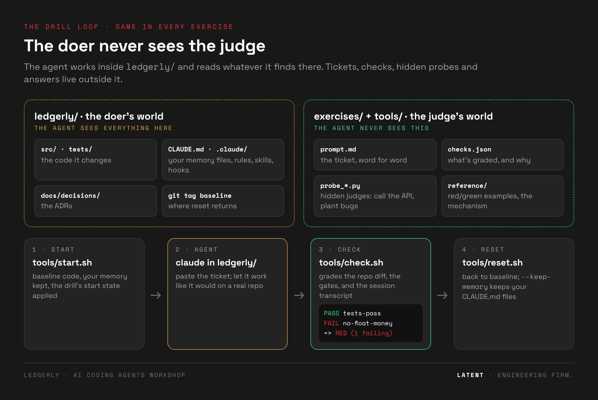

# 🧭 Exercise 0 · Orientation: the app, the tools, the loop

> ⏱️ **18 min** (or `tools/doctor.sh` as pre-work + a **10-min** version in class) · 📅 Day 1, right after the intro, before Ex 1
>
> 👉 **Students open [`exercise.html`](exercise.html)**. This README is the guide for both of you.


---

## 🎯 Goal

Ex 0 has no red to fix. It makes sure that when Ex 1 starts, nobody is lost. Every later exercise
assumes four things, and this one sets them up:

| | by the end of Ex 0, every student… | why it matters later |
|---|---|---|
| 🩺 | has **green gates** on their machine | if tests are red before the agent starts, every result after is noise |
| 🗺️ | knows **Ledgerly**: its layers, its ADRs, where the truth lives | you can't judge an agent's change to code you don't know |
| 📁 | can find their way around **any exercise folder** | Ex 1–8 all use the same shape: drills, checks, judges, reference, LESSONS |
| 🔁 | has run **the drill loop** once: start → agent → check → reset | it's the loop of every exercise, so it should feel routine by Ex 1 |

---

## 🗺️ The flow

| step | what students do | done when | ⏱️ |
|---|---|---|---|
| 0 · 🩺 **Doctor** | `tools/doctor.sh`: checks claude, uv, git, python3, the `baseline` tag, `uv sync`, pytest, ruff, import-linter; warns about `~/.claude/CLAUDE.md` | it prints **READY** | 2 |
| 1 · 🗺️ **Meet Ledgerly** | read the project map; run the app; in `/docs`, take one invoice open → paid → refunded | they can name the 3 layers | 4 |
| 2 · 💣 **Landmines** | four README claims; find where the truth really lives | a source of truth in every row | 3 |
| 3 · 📁 **Anatomy** | walk `exercises/ex00-orientation/`, list Ex 1's folders (names only) | they can say what prompt / checks / probe each do | 4 |
| 4 · 🔁 **The loop** | the tools table, then LED-100 with their own agent → `tools/check.sh led-100` → note it in LESSONS.md → `tools/reset.sh` | they've read a check report | 5 |

**⚡ 10-minute in-class version:** Step 0 as pre-work. In class: the Step 1 map (2 min), skim the
Step 3 table (3 min), run Step 4 (5 min). Steps 1–2 hands-on become homework.

---

## 🏗️ The workshop at a glance

```
ledgerly-workshop/
├── 📦 ledgerly/      the sample app. Its own git repo, tag `baseline`. Open Claude Code HERE.
├── 🧪 exercises/     one folder per exercise. The agent never sees this folder.
├── 🧰 tools/         start · check · reset · run_drill · doctor · demo_reference …
├── 🖼️ assets/        diagrams for the READMEs
├── 📊 runs/          transcripts + check results (created by the tools, git-ignored)
└── 💾 my-variants/   your saved CLAUDE.md attempts (tools/snapshot.sh)
```



**Why are the exercises outside the app?** The agent works inside `ledgerly/` and reads whatever
it finds there. An answer key next to the code would leak into its context. Keeping the judge where
the doer can't see it is a lesson of its own (you'll meet it again in Ex 3 and Ex 6).

---

## 📁 Anatomy of an exercise folder

Every exercise from Ex 0 to Ex 8 has the same parts.

| part | what it is | who uses it, and when |
|---|---|---|
| 🖥️ `exercise.html` | the student page: steps, tickets to paste, hints that unlock in order, a timer, a locked reference | students, during the exercise |
| 📘 `README.md` | **this kind of file**: goal, flow, how it's judged, folder map, facilitator notes | the trainer, and students afterwards |
| 📝 `LESSONS.md` | the takeaways + a table for **your own numbers** | students, at the end of each exercise |
| 🎫 `drills/<ticket>/` | one folder per ticket the agent works on | the tools |
| ↳ `prompt.md` | the ticket, word for word | pasted by you · used by `run_drill.sh` headless |
| ↳ `checks.json` | the list of checks; each has a `why` printed when it fails | `check.sh` · `run_drill.sh` |
| ↳ `probe_*.py` | **hidden judges**: call the API, plant bugs, read the diff | the checker, never the agent |
| ↳ `setup.sh` | optional start state (e.g. "LED-105 is already implemented") | `start.sh` runs it |
| ↳ `reference/` | `red.patch` / `green.patch`: hand-written typical bad and good outcomes (+ synthetic transcripts) | `demo_reference.sh`, when a live run won't cooperate |
| 🔓 `reference/` (top level) | **the answer**: the mechanism that turns red green (CLAUDE.md, rules, skills, hooks…), laid out like `ledgerly/` | `apply_variant.sh`, after you've tried |

> 💡 **Two kinds of "reference".** `drills/<ticket>/reference/` holds *outcomes* (what an agent
> typically produces, as patches). The top-level `reference/` holds *the mechanism* (the files you
> were supposed to write). Ex 0 has only the first kind: there's nothing to install yet.

### 🔍 How to read a check report

```
LED-100 · warm-up: the version endpoint
   PASS  tests-pass                          ← a gate: the command exited 0
   PASS  lint-clean
   PASS  endpoint-works   GET /version -> 200, version 0.4.2   ← a hidden probe called the API itself
   FAIL  new-behaviour-tested   expected change not found      ← a diff check against `baseline`
         ↳ New behaviour without a test. Nothing will notice when it breaks.   ← the `why`
   => RED (1 failing)
```

| check type (in `checks.json`) | what it looks at |
|---|---|
| `command` | runs a gate (pytest, ruff, …) in `ledgerly/` |
| `probe` | runs a hidden script from the drill folder against the app |
| `diff_present` / `diff_absent` / `diff_no_removals` / `files_unchanged` | the git diff since `baseline` |
| `transcript_present_*` / `transcript_absent` / `final_message_matches` | what the agent ran and said (Claude Code session file) |

---

## 🧰 The tools (run from the workshop root)

| tool | what it does | touches |
|---|---|---|
| 🩺 `tools/doctor.sh [--quick]` | is this machine ready? | creates `.venv` only |
| ▶️ `tools/start.sh <drill>` | baseline code, your memory files kept, the drill's `setup.sh` applied | `ledgerly/` |
| ✅ `tools/check.sh <drill>` | grade the repo + your newest Claude Code session | writes `runs/` |
| ↩️ `tools/reset.sh [--keep-memory]` | back to `baseline`. ⚠️ **deletes untracked files** unless `--keep-memory` | `ledgerly/` |
| 🎭 `tools/demo_reference.sh <drill> red\|green` | apply a hand-written example and check it, no agent needed | `ledgerly/` |
| 📥 `tools/apply_variant.sh <folder>` | copy a `reference/` (or a saved variant) into `ledgerly/` | `ledgerly/` |
| 💾 `tools/snapshot.sh <name>` | save your memory files to `my-variants/<name>` | `my-variants/` |
| 📊 `tools/run_drill.sh <drill> <none\|current\|folder> N` | N headless runs → a pass-rate table | `ledgerly/` · `runs/` |

Exercise-specific tools appear later: `observe.sh` and `memory_size.py` (Ex 1), `skill_lint.py` and
`skill_eval.py` (Ex 2), `hook_test.py` (Ex 3).

---

## 🎫 The warm-up drill: LED-100

`drills/led-100-version/`: *"add `GET /version` returning the version from `pyproject.toml`"*.

| check | type | catches |
|---|---|---|
| tests-pass | command | broken tests |
| lint-clean | command | ruff errors |
| endpoint-works | probe (`probe.py`) | wrong status or body. The probe calls the endpoint itself |
| new-behaviour-tested | diff | no test under `tests/` mentions `/version` |

The ticket doesn't ask for a test, so a red on `new-behaviour-tested` is common, and that's the
bridge into Ex 1: *whose job was it to say "every change comes with a test"?* Either result is
fine in Ex 0. Fallback: `tools/demo_reference.sh led-100 red|green`.

---

## 📂 This folder

```
ex00-orientation/
├── exercise.html            the student page (5 steps, 18-min timer)
├── README.md                this file
├── LESSONS.md               takeaways + "your numbers"
├── img/anatomy.png          the diagram at the top
└── drills/led-100-version/
    ├── prompt.md            the ticket
    ├── checks.json          4 checks
    ├── probe.py             hidden judge: calls GET /version
    └── reference/           red.patch (endpoint, no test) · green.patch (endpoint + test)
```

---

## 🧑‍🏫 Before class

1. Send students the page and ask them to run `tools/doctor.sh` before they arrive.
2. Run `tools/doctor.sh` on the machine you present from.
3. Optional: `tools/run_drill.sh led-100 none 3` to have a rate to show in Step 4.

## 🖱️ Cursor sidebar

Steps 0–3 are tool-agnostic. For Step 4, open `ledgerly/` in Cursor, paste LED-100 into the agent
and run `tools/check.sh led-100`. All four checks grade the repo, so no Claude Code session is needed.

## 📝 Lessons

See [`LESSONS.md`](LESSONS.md). **Next:** [Ex 1 · CLAUDE.md + rules](../ex01-claude-md/), where the
first real red appears.
