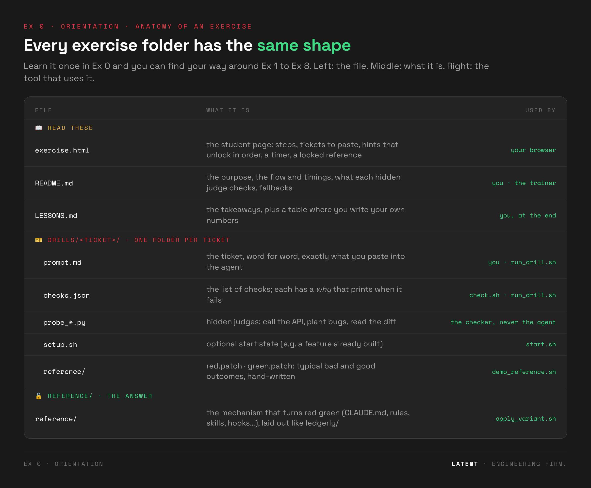

# 🧭 Exercise 0 · Orientation: the app, the tools, the loop

> ⏱️ **15 min** (or `tools/doctor.sh` as pre-work + a **10-min** version in class) · 📅 Day 1, before Ex 1
>
> 👉 **Students open [`exercise.html`](exercise.html)**. It has the same steps as this README, with copy buttons.

**The point:** learn the loop every exercise uses, once, on an easy ticket:

```
🔴 check first (red)  →  🤖 agent does the ticket  →  ✅ check again  →  ↩️ reset
```

> 🤖 **Use Haiku** for the whole workshop: `claude --model haiku`. It's fast and cheap, and its
> mistakes are easy to see.

---

## ▶️ Do it

All commands run from the **workshop root** (`ledgerly-workshop/`) unless they say `cd ledgerly`.

### 1 · 🩺 Is your machine ready? (2 min)

```bash
tools/doctor.sh
```

It checks claude, uv, git, python3, the `baseline` tag, `uv sync`, pytest, ruff and import-linter.
Done when it prints **READY**. If you have a `~/.claude/CLAUDE.md` it warns you: that file loads into
every session (Ex 1 deals with it).

### 2 · 🗺️ Meet Ledgerly (4 min)

Ledgerly is a small invoicing API: FastAPI, SQLite, uv. Three layers, enforced by import-linter:

```
api/  (HTTP only)  →  services/  (business rules)  →  repo/  (SQL)        payments/: Money in integer cents
```

```bash
uv --directory ledgerly run uvicorn ledgerly.api.app:app   # open http://127.0.0.1:8000/docs
```

In `/docs`, create an invoice, capture it (paid), refund it. `Ctrl-C` to stop.

**Landmines on purpose:** `ledgerly/README.md` is from 2021 and wrong (Flask, `make test`, dollars).
The truth lives in `pyproject.toml`, the code and `docs/decisions/` (ADRs). An agent reads all of it,
and doesn't know which one to trust.

### 3 · 🔴 Check first: see it red (1 min)

```bash
tools/check.sh led-100
```

```
   PASS  tests-pass
   PASS  lint-clean
   FAIL  endpoint-works         GET /version -> 404
   FAIL  new-behaviour-tested   expected change not found
   => RED (2 failing)
```

Every exercise starts here: the check is red **before** the agent touches anything. A check you've
never seen fail proves nothing.

### 4 · 🤖 Give the ticket to the agent (5 min)

```bash
cd ledgerly && claude --model haiku
```

Paste:

```text
LED-100 — Version endpoint

Ops wants to see which build is running. Add `GET /version` returning
`{"name": "ledgerly", "version": "<the version in pyproject.toml>"}`.
```

Wait for "done", then `/exit`.

### 5 · ✅ Check again, then reset (2 min)

```bash
cd .. && tools/check.sh led-100
tools/reset.sh                       # ledgerly/ back to baseline for Ex 1
```

`endpoint-works` should now pass. `new-behaviour-tested` is often still red: the ticket didn't ask
for a test. *Whose job was it to say "every change comes with a test"?* That's Ex 1. Write your result
in [`LESSONS.md`](LESSONS.md).

**⚡ 10-minute version:** step 1 as pre-work, skip step 2's server, do steps 3–5.

---

## 🔍 How to read a check report

```
LED-100 · warm-up: the version endpoint
   PASS  tests-pass                          ← a command: pytest exited 0
   PASS  endpoint-works   GET /version -> 200, version 0.4.2   ← a hidden probe called the API itself
   FAIL  new-behaviour-tested   expected change not found      ← the git diff since `baseline`
         ↳ New behaviour without a test.     ← the `why`, printed when a check fails
   => RED (1 failing)
```

The checker never reads the agent's summary. It grades the **repo** (commands, probes, diff) and,
in some drills, the **transcript** (what the agent ran).

## 🧰 The tools (run from the workshop root)

| tool | what it does |
|---|---|
| `tools/doctor.sh` | is this machine ready? |
| `tools/check.sh <drill>` | grade `ledgerly/` (+ your newest Claude Code session) against the drill's checks |
| `tools/reset.sh [--keep-memory]` | back to `baseline`. ⚠️ **deletes untracked files**, your CLAUDE.md too, unless `--keep-memory` |
| `tools/start.sh <drill>` | reset (keeping memory files) + apply the drill's start state, if it has one |
| `tools/run_drill.sh <drill> <none\|current\|folder> N` | N headless runs → a pass-rate table. `MODEL=haiku` to pick the model |
| `tools/demo_reference.sh <drill> red\|green` | apply a saved example and check it, no agent needed |
| `tools/apply_variant.sh <folder>` | copy a `reference/` folder into `ledgerly/` |
| `tools/snapshot.sh <name>` | save your memory files to `my-variants/<name>` |

## 📁 Every exercise folder has the same shape



| part | what it is |
|---|---|
| `exercise.html` | the student page: steps, tickets to paste, hints, a timer |
| `README.md` | the same steps + how it's judged + facilitator notes |
| `LESSONS.md` | takeaways + a table for **your own numbers** |
| `drills/<ticket>/prompt.md` | the ticket, word for word |
| `drills/<ticket>/checks.json` | the checks; each has a `why` printed when it fails |
| `drills/<ticket>/probe*.py` | **hidden judges**: call the API, read the diff. The agent never sees them |
| `drills/<ticket>/reference/` | `red.patch` / `green.patch`: example outcomes for `demo_reference.sh` |
| `reference/` (top level) | **the answer**: the CLAUDE.md, rules, hooks… that turn red green |

**Why are the exercises outside `ledgerly/`?** The agent reads whatever is in its folder. An answer
key next to the code would leak into its context. Keep the judge where the doer can't see it.

---

## 🧑‍🏫 Before class

1. Ask students to run `tools/doctor.sh` before they arrive.
2. Run it on the machine you present from.
3. Optional: `MODEL=haiku tools/run_drill.sh led-100 none 3` for a rate to show in step 5.
   Fallback: `tools/demo_reference.sh led-100 red|green`.

**Cursor:** steps 1–3 and 5 are tool-agnostic. For step 4 open `ledgerly/` in Cursor and paste the
ticket. All LED-100 checks grade the repo, so no Claude Code session is needed.

**Next:** [Ex 1 · CLAUDE.md](../ex01-claude-md/), where green tests turn out to be wrong.
