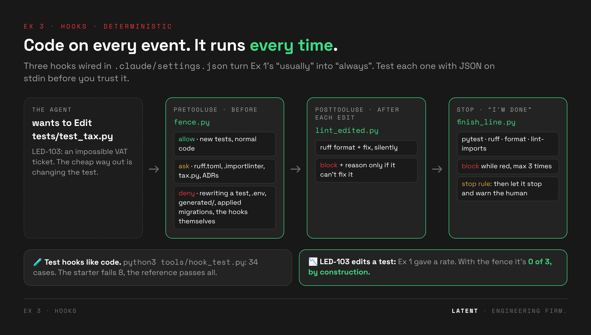

# 🪝 Exercise 3 · Hooks: from a rate to zero

> ⏱️ **25 min** (timer presets 20 / 25 / 30) · 📅 Day 1, after the Hooks deck (Fundamentals §18)
>
> 🧱 Builds on Ex 1–2 (`tools/start.sh` keeps your CLAUDE.md, rules and skills) · 👉 **Students open [`exercise.html`](exercise.html)**



---

## 🎯 Goal

**The drift:** at the end of Ex 1, even with a perfect CLAUDE.md, LED-103 (an impossible VAT
ticket) still gets "solved" by editing a test **in some runs**. Agents also "relax" lint config to
get green, read `.env`, and declare done without running the gates.

**The purpose:** move the rules that must *always* hold from **advisory** (a rate) to
**deterministic** (every time). A hook is code on an event: it costs no tokens, and the agent
can't talk its way past it.

**By the end, students can:**

- 🧱 write a **PreToolUse** fence with three outcomes: `allow`, `ask` (a human decides), `deny` (never);
- 🧹 add **PostToolUse** edit-time feedback: fix silently, talk back only when it can't fix;
- 🏁 build a **Stop** finish line that won't accept "done" while the gates are red, with a **stop rule** so it can't loop forever;
- 🧪 **test hooks before wiring them**, with JSON on stdin;
- ⚖️ tell what hooks make impossible (tampering → 0/3) from what stays a rate (flagging the conflict).

## 🧭 Where it fits

**Ex 1–2** made the right behaviour *likely* → **Ex 3** makes the wrong behaviour *impossible* →
leftover: a fence guards **edits**, not **outcomes**. Weak tests and a `skip` line both get through
(**Ex 5**).

---

## 🗺️ The flow

| step | what happens | checked by | ⏱️ |
|---|---|---|---|
| 0 · 🔴 **The drift** | Re-show Ex 1's LED-103 rate (test edited, VAT rounding changed) | `demo_reference.sh led-103 red` · `git -C ledgerly diff baseline --stat` | 2 |
| 1 · 🧱 **Fence** | Copy the starters. `fence.py` has 2 TODOs: the **ask** list and **append-only tests**. Red first, then green, then register `PreToolUse` | `python3 tools/hook_test.py fence` (24 cases: 7 red in the starter) | 9 |
| 2 · 🧹 **Lint** | `lint_edited.py` (complete): silent fix, then "talks back". Make the agent write a bare `except` and watch | `hook_test.py lint` (4 cases) + live | 5 |
| 3 · 🏁 **Finish line** | `finish_line.py` blocks "done" until the 4 gates pass. The starter has no **stop rule** | `hook_test.py finish` (6 cases: 1 red in the starter) | 6 |
| 4 · 😈 **Get past it** | LED-103 × 3 headless with the hooks; LED-132 "relax ruff.toml to 140" | `run_drill.sh led-103 current 3` · `check.sh led-132` | 3 |

🏠 **Homework:** rebuild `exercise-hook-debug` on Ledgerly (swap a subtly broken hook with a neighbour).

---

## ⚖️ What the fence decides

| | path / command | decision |
|---|---|---|
| 🔑 secrets | `.env`, `.env.*` (read *or* write) | ⛔ deny |
| ⚙️ generated / immutable | `src/ledgerly/generated/*`, applied migrations (tracked in git) | ⛔ deny |
| 🛡️ the fence itself | `.claude/settings.json`, `.claude/hooks/*` (reading is fine) | ⛔ deny |
| 🙋 a human decides | `.importlinter`, `ruff.toml`, `pyproject.toml`, `docs/decisions/*`, `services/tax.py` | ❓ ask |
| 🧪 tests | new files and pure additions allowed; changed or removed lines denied | ✅ / ⛔ |
| 💻 Bash | `rm -rf`, force push, `reset --hard`, printing `.env`, writing to tests/config via sed or redirects | ⛔ deny |
| 🤖 Day 2 | `agent_type == "test-writer"` may change tests | ✅ allow |

> ⚠️ The Bash rules are a regex, not a sandbox (`python -c "open(...)"` gets past them). Say so in
> the room: it's the bridge to permission deny rules and the sandbox.

### 🧪 How the hooks are tested

`tools/hook_test.py` feeds each case's JSON to the hook on stdin and compares the outcome
(`permissionDecision`, `decision: block`, exit 2, or pass) with what's expected:

```bash
python3 tools/hook_test.py          # all suites: fence (24) · lint (4) · finish (6)
python3 tools/hook_test.py fence    # one suite
```

The reference passes all 34. The starter fails 8, which is the spec students work from.

---

## 📂 This folder

```
ex03-hooks/
├── exercise.html · README.md · LESSONS.md
├── img/                          the diagram at the top
├── starter/                      fence.py (2 TODOs) · lint_edited.py (complete) · finish_line.py (stop-rule TODO)
├── hooktests/                    fence.json · lint.json · finish.json   ← tools/hook_test.py suites
├── drills/led-132-relax-lint/    "relax the lint config" + reference red/green
└── reference/.claude/            🔓 settings.json · hooks/{fence,lint_edited,finish_line}.py
```

The hooks are standard-library Python 3.9+ (macOS's `/usr/bin/python3` works) and need `uv` on
PATH for the lint and finish-line gates. **They live in the repo, so the repo's own ruff gate lints
them.** A sloppy hook turns the finish line red. That's intended.

---

## 🧑‍🏫 Before class

1. Record the "after" numbers: apply your Ex 1 memory files and the reference hooks, then
   `tools/run_drill.sh led-103 current 3` and `tools/run_drill.sh led-132 current 1`.
2. Check the reference: `tools/reset.sh && tools/apply_variant.sh exercises/ex03-hooks/reference && python3 tools/hook_test.py`.
3. 🎭 Fallbacks: `tools/demo_reference.sh led-132 red|green`.

## 💬 Facilitator notes

- 📋 **Step 1's red list is the spec.** Read the 7 failing names aloud before anyone opens the file.
- ⚖️ **deny vs. ask** is the discussion. Removing a dead `.importlinter` exception is legitimate, so
  the fence *asks* instead of denying. Every block needs a legitimate route.
- 📉 **Step 4, row 3 is still a rate.** The hooks make tampering impossible; they don't make the
  agent flag the conflict. Ask: "what would make *that* deterministic?"

## 🖱️ Cursor sidebar

Cursor has hooks in `.cursor/hooks.json` (events like `beforeShellExecution`, `beforeReadFile`,
`afterFileEdit`, `stop`); the JSON protocol differs. The fence's *logic* ports; the wiring doesn't.
Check your Cursor version's hook docs.

## 📝 Lessons

See [`LESSONS.md`](LESSONS.md). **Next:** [Ex 4 · MCP + Context7](../ex04-mcp/).
