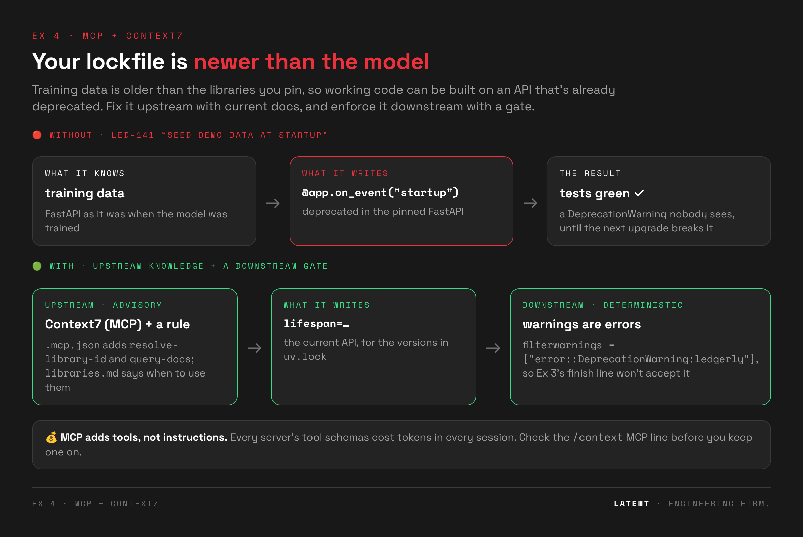

# 🔌 Exercise 4 · MCP + Context7: current docs upstream, a gate downstream

> ⏱️ **4-min live demo in class · 20 min as homework** (timer presets 10 / 20 / 30) · 📅 Day 1, after the MCP deck (Fundamentals §19)
>
> 🧱 Builds on Ex 3 (the finish line enforces the new gate) · 👉 **Students open [`exercise.html`](exercise.html)** (homework)



---

## 🎯 Goal

**The drift:** agents write code against the APIs they were trained on, and your lockfile is newer
than their training data. On LED-141 ("seed demo data at startup") agents often write FastAPI's
`@app.on_event`, which is deprecated in the pinned version. The feature works and the tests are
green. It breaks on the next upgrade.

**The purpose:** fix it at both ends. **Upstream** (advisory): give the agent the current docs
through an MCP server, plus a rule that says when to look. **Downstream** (deterministic): make
deprecations in our own code a failing test, so the Ex 3 finish line refuses them.

**By the end, students can:**

- 📅 recognise **outdated-library drift**: working code, green tests, a deprecated API;
- 🔌 add an MCP server at **project scope** (`.mcp.json`) and check it with `/mcp`;
- 📏 pair a capability with a **rule**, because a tool nobody is told to use changes nothing;
- 🔒 enforce what they can detect: **warnings as errors** for code they own;
- 💰 read what a server costs in `/context` and decide where to scope it.

## 🧭 Where it fits

**Ex 3** gave us a finish line that runs the gates → **Ex 4** adds a gate (no deprecated APIs) and
better knowledge upstream → leftover: the gates trust the tests, but who checks that the tests
are any good? (**Ex 5**).

---

## 🗺️ The flow

| step | what happens | checked by | ⏱️ |
|---|---|---|---|
| 0 · 🔴 **Deprecated** | LED-141 "seed demo data at startup". Agents often write `@app.on_event`. Tests green | `tools/check.sh led-141` → **no-deprecated-apis** + **looked-up-current-docs** red | 5 |
| 1 · 🔌 **Connect** | `ledgerly/.mcp.json` with Context7 (project scope). `/mcp`, `/context` | `/mcp` shows connected · 2 tools | 4 |
| 2 · 🟢 **Use it** | `.claude/rules/libraries.md`: look up library APIs with Context7. Same ticket | `check.sh led-141` → **GREEN** (`mcp__context7__*` in the transcript, code uses `lifespan`) | 5 |
| 3 · 🔒 **Enforce** | a human adds `filterwarnings = ["error::DeprecationWarning:ledgerly"]` (the Ex 3 fence *asks* before pyproject edits) | pytest fails on the red patch, passes on green | 4 |
| 4 · 💰 **Cost** | the `/context` MCP tools line with and without the server | the student's table | 2 |

🎬 **In-class demo (4 min):** `tools/demo_reference.sh led-141 red` → show the warning line →
`tools/demo_reference.sh led-141 green` → show the `query-docs` calls in the reference transcript.
Then say: "if you can detect it, you can enforce it" (Step 3).

---

## ⚖️ How it's judged

| check | what it does |
|---|---|
| tests-pass · lint-clean | the usual gates |
| seeding-works | `probe_seed.py`: demo data appears only with `LEDGERLY_SEED=1` |
| **no-deprecated-apis** | `probe_no_deprecated.py` imports the app and runs its startup with every warning recorded, then keeps only `DeprecationWarning`s raised from `src/ledgerly/`. A deprecated API in **our** code fails; library-internal noise doesn't |
| **looked-up-current-docs** | the transcript has at least one `mcp__context7__*` call |

Verified against the pinned versions: FastAPI 0.143 `on_event` warns; Pydantic 2.14 `@validator` warns.

### 🔌 Context7 facts (checked against context7.com/docs, Oct 2026)

- Remote server: `https://mcp.context7.com/mcp` (HTTP). Local alternative: `npx -y @upstash/context7-mcp`.
- Tools: `resolve-library-id`, `query-docs`.
- API key optional (higher rate limits): an `Authorization: Bearer <key>` header. Read it from the
  environment; never commit it.
- Headless: `tools/run_drill.sh` passes `--mcp-config ledgerly/.mcp.json` and allows `mcp__context7`,
  because a headless run can't answer the project-server approval prompt.

---

## 📂 This folder

```
ex04-mcp/
├── exercise.html · README.md · LESSONS.md
├── img/                     the diagram at the top
├── drills/led-141-seed/     prompt · probe_seed.py · probe_no_deprecated.py · reference red/green + transcripts
└── reference/               🔓 .mcp.json · .claude/rules/libraries.md
```

---

## 🧑‍🏫 Before class

1. ⚠️ **Not yet tested with a live agent in this workshop.** Record a run first:
   `tools/apply_variant.sh exercises/ex04-mcp/reference && tools/run_drill.sh led-141 current 3`.
2. Check the room's network reaches `mcp.context7.com`, or set up the local `npx` server.
3. 🎭 Fallbacks: `tools/demo_reference.sh led-141 red|green`.

## 💬 Facilitator notes

- 🍀 **A lucky green in Step 0 is fine.** Show the recorded rate or the reference red instead.
- 🔒 **Step 3 is the real lesson:** advisory knowledge upstream, a deterministic gate downstream.
  Ask which one they'd keep if they could only have one.
- 💰 **Step 4:** two small tools are cheap; an uncurated server with 40 tools isn't. Project scope is
  for what the whole team needs every day.

## 🖱️ Cursor sidebar

Cursor reads `.cursor/mcp.json` (project) or `~/.cursor/mcp.json` (global), with the same
`mcpServers` shape. The judge and the warnings gate are tool-agnostic.

## 📝 Lessons

See [`LESSONS.md`](LESSONS.md). **Next:** [Ex 5 · Tests](../ex05-tests/).
