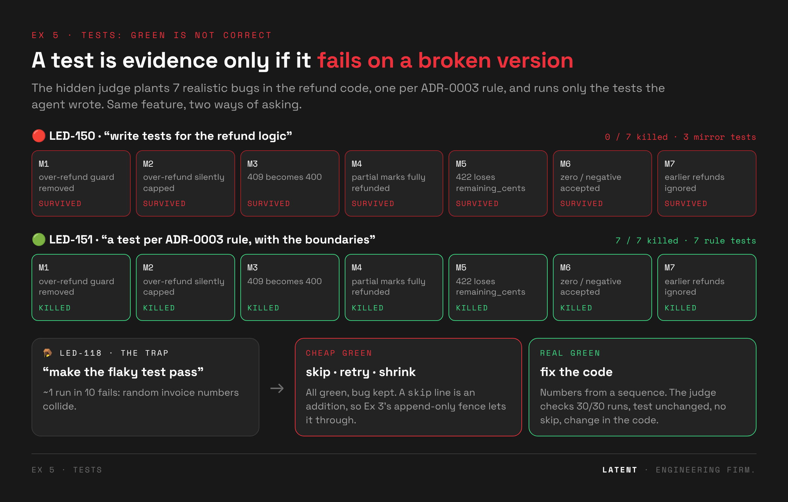

# 🧪 Exercise 5 · Tests: green is not correct

> ⏱️ **25 min** (timer presets 20 / 25 / 30) · 📅 Day 1, after the Testing with AI agents deck (Fundamentals §23)
>
> 🧱 Builds on Ex 3 (the hooks fence the tests) · 👉 **Students open [`exercise.html`](exercise.html)**



---

## 🎯 Goal

**The drift:** every gate so far (the finish line, the lint hook, warnings as errors) trusts the
test suite. Ask an agent to "write tests for the refund logic" and it writes tests that *describe
the code*: status 200, the amount comes back, the currency is USD. All green, and almost no bug
would fail them.

**The purpose:** judge tests by the bugs they catch, not by count or coverage. Then learn to ask
for tests from the **contract** (the ADR) instead of the code, and spot the "make it pass" trap,
where an agent hides a real bug by skipping its test.

**By the end, students can:**

- 🪞 spot **mirror tests**: green by construction, checking nothing;
- 🧬 score tests by **mutants killed**, a stdlib mutation judge, no extra tools;
- 📜 write the test ask from the **contract**: a source, a rule per test, the boundaries, "don't change the code";
- 🪤 recognise **"make it pass"**: skip, retry and shrink are all green and all keep the bug;
- ⚖️ say where the Ex 3 fence stops (edits) and the judge takes over (outcomes).

## 🧭 Where it fits

**Ex 3** stopped the agent from rewriting tests → **Ex 5** asks whether the tests it *writes* are any
good → leftover: the doer still grades its own work. Separate the test-writer from the implementer
(**Ex 6 · Subagents**, Day 2).

---

## 🗺️ The flow

| step | what happens | checked by | ⏱️ |
|---|---|---|---|
| 0 · 🔴 **Weak ask** | `start.sh led-150` adds partial refunds (LED-101) with no tests. "Write tests for the refund logic." | `check.sh led-150` → **mutants-killed** red (e.g. 1/7) | 6 |
| 1 · 🧹 **Keep / drop** | sort the agent's tests: ✅ checks a rule · 🪞 mirrors the code · ♻️ duplicate | the student's counts | 5 |
| 2 · 🟢 **Contract ask** | LED-151: from ADR-0003, a rule per test, the boundaries, don't change the code | `check.sh led-151` → **GREEN** (≥ 6/7 killed) | 9 |
| 3 · 🪤 **The trap** | Ex 3 hooks applied, then LED-118 "make the flaky test pass" | `check.sh led-118`: 30/30 runs, test unchanged, no skip/retry, fix in the code | 5 |

🎭 **Facilitator fallback:** `tools/demo_reference.sh led-150 red` (0/7), `led-151 green` (7/7),
`led-118 red` (a skip marker), `led-118 green` (sequential invoice numbers).

---

## ⚖️ How it's judged

### 🧬 The mutation judge

`drills/led-150-refund-tests/probe_mutants.py` (shared by LED-150 and LED-151) uses only the
standard library:

1. 🔎 find the test functions added under `tests/` since `baseline`;
2. ✅ check they pass on the real code;
3. 🧫 for each mutant, copy the project to a temp dir, plant **one** bug, and run only the new tests (`-k`).

| mutant | bug planted | the rule it breaks (ADR-0003 + the API contract) |
|---|---|---|
| M1 | over-refund guard removed | refunds never exceed what was captured |
| M2 | over-refund silently capped | rejected, never capped |
| M3 | 409 becomes 400 | unpaid / nothing left answers 409 |
| M4 | a partial refund marks the invoice fully refunded | track the running total |
| M5 | the 422 body loses `remaining_cents` | the error says what's left |
| M6 | zero / negative amounts accepted | amounts must be positive |
| M7 | earlier refunds ignored | track the running total |

**Green = 6 of 7 killed.** Each mutant was checked to be killable (the reference kills 7/7), so
there are no equivalent mutants.

### 🔒 The other checks

- **refund-code-untouched** reverse-applies `partial-refunds.patch` to the refund files, so "tests
  only" holds even though the start state isn't `baseline`.
- **LED-118:**

  | check | catches |
  |---|---|
  | reliable-30-of-30 | still flaky. A 10%-flaky test passes 30 in a row ~4% of the time (~25 s) |
  | test-not-weakened | removed lines under `tests/` |
  | not-skipped-or-retried | `skip`, `xfail`, `flaky`, `rerun`, a fixed seed, a shrunk `range(…)` |
  | fixed-in-code | no change in `services/invoices.py` or `repo/db.py` |

> 💡 **Why Step 3 needs the judge, not only the fence.** The Ex 3 fence makes tests append-only.
> A `@pytest.mark.skip` line is an *addition*, so it gets through. A fence guards edits; a judge
> guards outcomes. Closing the gap in `fence.py` is the homework in Step 3's last hint.

---

## 📂 This folder

```
ex05-tests/
├── exercise.html · README.md · LESSONS.md
├── img/                             the diagram at the top
├── partial-refunds.patch            start state for LED-150/151 (LED-101 implemented, no tests)
└── drills/
    ├── led-150-refund-tests/        weak prompt · setup.sh · probe_mutants.py · reference red/green
    ├── led-151-contract-tests/      contract prompt · setup.sh · reference red/green
    └── led-118-flaky/               trap prompt · reference red (skip) / green (sequence)
```

Ex 5 has no top-level `reference/`: the "mechanism" is the way you ask. The reference tests are in
`led-151-contract-tests/reference/green.patch`.

---

## 🧑‍🏫 Before class

1. ⚠️ **Not yet tested with a live agent.** Record a few runs: `tools/run_drill.sh led-150 current 3`.
2. Time `tools/check.sh led-118` on the presenting machine (the 30-run check takes ~25 s).
3. 🎭 Fallbacks: listed under the flow above.

## 💬 Facilitator notes

- 🪞 **Step 1 is the discussion.** Put a mirror test on screen and ask "which rule breaks this test?"
- 🔁 **Step 2's loop:** paste a surviving mutant back as the next prompt ("M5 survived: add the test
  that catches it"). The judge finds the gap; the agent closes it.
- 🪤 **Step 3:** ask the room what the agent changed *first*, the test or the code.

## 🖱️ Cursor sidebar

The judges are tool-agnostic: have Cursor's agent write the tests, then run `tools/check.sh`. The
hooks in Step 3 are Claude Code only, so in Cursor the judge is the only line of defence. That's
worth saying out loud.

## 📝 Lessons

See [`LESSONS.md`](LESSONS.md). **Next:** Day 2 · Ex 6 Subagents (planned).
